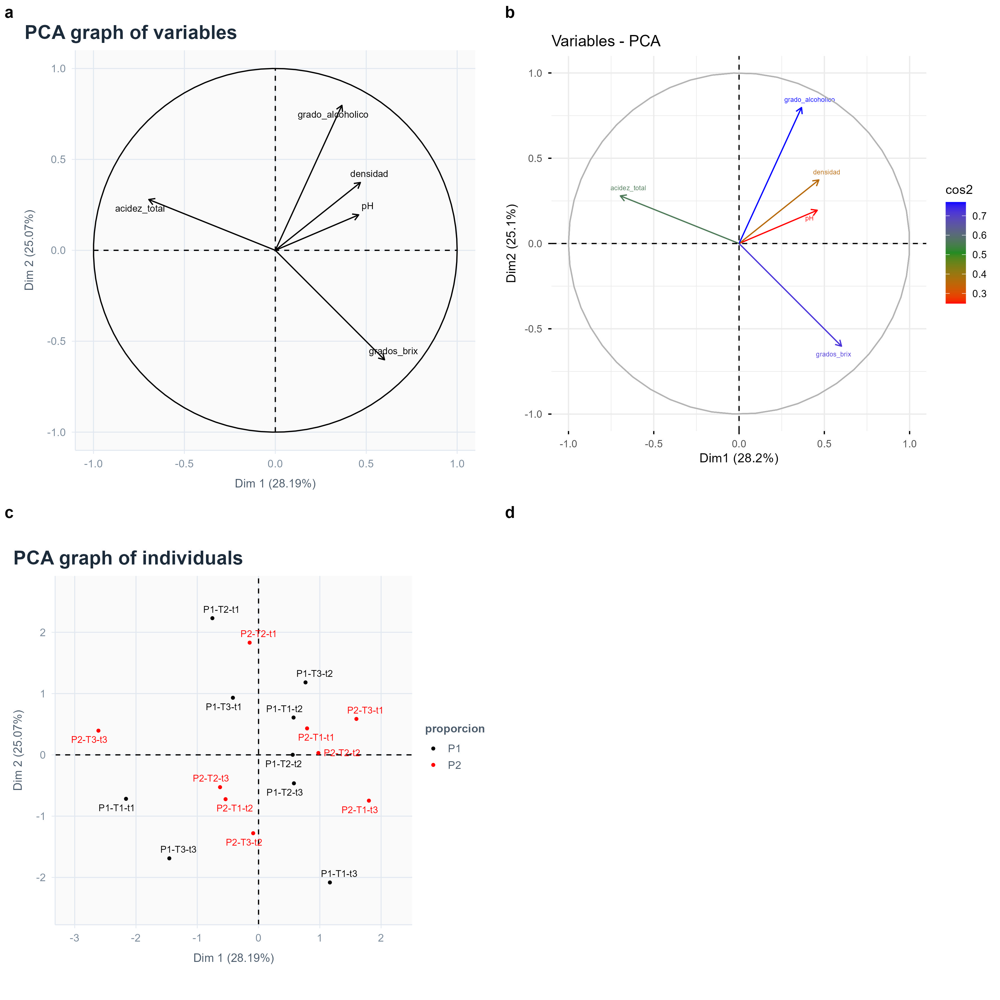

# Análisis de diseño experimental

## Base de datos

La base de datos contiene 18 tratamientos, evaluados en tres bloques, con un total de 54 observaciones.

## Identificación de los factores

1. **Factor A: Proporción de maltas**
   - P1: 40 % de maíz morado y 60 % de quinua.
   - P2: 60 % de maíz morado y 40 % de quinua.

2. **Factor B: Tiempo de tostado**
   - T1: 105 minutos.
   - T2: 115 minutos.
   - T3: 125 minutos.

3. **Factor C: Temperatura de tostado**
   - t1: 100 °C.
   - t2: 110 °C.
   - t3: 120 °C.

## Diseño experimental

Diseño de Bloques Completos al Azar (DBCA) con arreglo factorial 2 × 3 × 3 y tres bloques.


$$Y_{ijkl}=\mu+B_l+A_i+T_j+Temp_k+(A\times T)_{ij}
+(A\times Temp)_{ik}+(T\times Temp)_{jk}
+(A\times T\times Temp)_{ijk}+\varepsilon_{ijkl}$$


# Configuración y paquetes

```{r}
source("https://inkaverse.com/setup.r")

library(googlesheets4)
library(dplyr)
library(tidyr)
library(emmeans)
library(multcomp)
library(ggplot2)

gs4_deauth()
```

# Importación de datos

```{r}
# Reemplazar el texto entre comillas por el enlace de Google Sheets.
gs <- "https://docs.google.com/spreadsheets/d/1Ghnx_ZC7K33HhyMXbC6sK0W6s1_27C13o-F9-NmGItw/edit?gid=0#gid=0" %>%
  as_sheets_id()

fb <- gs %>%
  range_read(
    ss = .,
    sheet = "fb",
    col_types = "c"
  ) %>%
  mutate(
    bloque = as.factor(bloque),
    tratamiento = as.factor(tratamiento),
    proporcion = factor(substr(as.character(tratamiento), 1, 2)),
    tiempo = factor(substr(as.character(tratamiento), 3, 4)),
    temperatura = factor(substr(as.character(tratamiento), 5, 6)),
    across(
      c(grados_brix, pH, densidad, grado_alcoholico, acidez_total),
      ~ readr::parse_number(as.character(.x))
    )
  )

str(fb)
summary(fb)
```

# Análisis de varianza y comparación de medias

## 1. Grados Brix

# Análisis de variancia

```{r}

md_brix <- aov(
  grados_brix ~ bloque + proporcion * tiempo * temperatura,
  data = fb
)
anova(md_brix)

# Comparación de medias

mc_brix <- emmeans(md_brix, ~ proporcion * tiempo * temperatura)
multcomp::cld(
  mc_brix, 
  adjust = "tukey", 
  Letters = letters)
```

# Representación gráfica

```{r}

# Interacción A × B × C

# 1. Obtener medias estimadas
mc_brix <- emmeans(
  md_brix,
  ~ proporcion * tiempo * temperatura
)

# 2. Agrupación de medias con Tukey
tab <- multcomp::cld(
  mc_brix,
  adjust = "tukey",
  Letters = letters
) %>%
  as.data.frame()

# 3. Representación gráfica
pl <- plot_smr(
  data = tab,
  x = "tiempo",
  y = "emmean",
  group = "proporcion",
  error = "SE",
  sig = ".group",
  ylab = "Grados Brix"
) +
  ggplot2::facet_wrap(~ temperatura) +
  ggplot2::labs(
    x = "Tiempo de tostado (min)",
    y = expression("Grados Brix ("*degree*"Brix)"),
    color = "Proporción de maltas",
    title = "Interacción A × B × C"
  )

# 4. Mostrar gráfico
pl

```

## 2. pH

```{r}
md_ph <- aov(
  pH ~ bloque + proporcion * tiempo * temperatura,
  data = fb
)
anova(md_ph)

# Comparación de medias

mc_ph <- emmeans(md_ph, ~ proporcion * tiempo * temperatura)
multcomp::cld(mc_ph, adjust = "tukey", Letters = letters)
```

# Representación gráfica

```{r}

# 1. Obtener medias estimadas
mc_ph <- emmeans(
  md_ph,
  ~ proporcion * tiempo * temperatura
)

# 2. Agrupación de medias con Tukey
tab_ph <- multcomp::cld(
  mc_ph,
  adjust = "tukey",
  Letters = letters
) %>%
  as.data.frame()

# 3. Representación gráfica
pl_ph <- plot_smr(
  data = tab_ph,
  x = "tiempo",
  y = "emmean",
  group = "proporcion",
  error = "SE",
  sig = ".group",
  ylab = "pH"
) +
  ggplot2::facet_wrap(~ temperatura) +
  ggplot2::labs(
    x = "Tiempo de tostado (min)",
    y = "pH",
    color = "Proporción de maltas",
    title = "Interacción A × B × C para pH"
  )

# 4. Mostrar gráfico
pl_ph

```


## 3. Densidad

```{r}
md_densidad <- aov(
  densidad ~ bloque + proporcion * tiempo * temperatura,
  data = fb
)
anova(md_densidad)

# Comparación de medias

mc_densidad <- emmeans(md_densidad, ~ proporcion * tiempo * temperatura)
multcomp::cld(mc_densidad, adjust = "tukey", Letters = letters)
```

## 4. Grado alcohólico

```{r}
md_alcohol <- aov(
  grado_alcoholico ~ bloque + proporcion * tiempo * temperatura,
  data = fb
)
anova(md_alcohol)

# Comparación de medias

mc_alcohol <- emmeans(md_alcohol, ~ proporcion * tiempo * temperatura)
multcomp::cld(mc_alcohol, adjust = "tukey", Letters = letters)
```


## 5. Acidez total

```{r}
md_acidez <- aov(
  acidez_total ~ bloque + proporcion * tiempo * temperatura,
  data = fb
)
anova(md_acidez)

# Comparación de medias

mc_acidez <- emmeans(md_acidez, ~ proporcion * tiempo * temperatura)
multcomp::cld(mc_acidez, adjust = "tukey", Letters = letters)
```


```{r}
#| label: setup

source('https://inkaverse.com/setup.r')
```

# Importación de datos

```{r}
# Reemplazar el texto entre comillas por el enlace de Google Sheets.
gs <- "https://docs.google.com/spreadsheets/d/1Ghnx_ZC7K33HhyMXbC6sK0W6s1_27C13o-F9-NmGItw/edit?gid=0#gid=0" %>%
  as_sheets_id()

fb <- gs %>%
  range_read(
    ss = .,
    sheet = "fb",
    col_types = "c"
  ) %>%
  mutate(
    bloque = as.factor(bloque),
    tratamiento = as.factor(tratamiento),
    proporcion = factor(substr(as.character(tratamiento), 1, 2)),
    tiempo = factor(substr(as.character(tratamiento), 3, 4)),
    temperatura = factor(substr(as.character(tratamiento), 5, 6)),
    across(
      c(grados_brix, pH, densidad, grado_alcoholico, acidez_total),
      ~ readr::parse_number(as.character(.x))
    )
  )

str(fb)
summary(fb)
```

# Multivariate


```{r}

#| eval: false

library(factoextra)

dtx <- fb %>% 
  dplyr::select(-c("bloque", "tratamiento")) %>% 
  group_by(proporcion, tiempo, temperatura) %>%
  summarise(across(where(is.numeric), ~ mean(.x, na.rm = TRUE)),
            .groups = "drop") %>% 
  
  unite("rowname", c("proporcion", "tiempo", "temperatura"),
        remove = FALSE, sep = "-") %>% 
  column_to_rownames("rowname") %>% 
  as.data.frame()

str(dtx)
  
mv <- dtx %>% 
  PCA(scale.unit = TRUE
      , graph = FALSE
      , quali.sup = c(1, 2, 3))

var <- mv %>% 
  plot.PCA(choix = "var", cex = 0.7)

var

cos <- mv %>% 
  fviz_pca_var(col.var = "cos2"
               , gradient.cols = c("red", "forestgreen", "blue")
               , repel = TRUE
               , labelsize = 2)

cos

ind <- mv %>% 
  plot.PCA(choix = "ind"
           , cex = 0.7
           , label = "ind"
           , invisible = "quali"
           , habillage = 1
           )

ind

pcainfo <- mv$var

pcainfo$coord %>% kable(caption = "Variable correlations")
pcainfo$contrib %>% kable(caption = "Variable Contribution")
pcainfo$cos2 %>% kable(caption = "Variable Cos2")

cls <- mv %>% HCPC(nb.clust = -1, graph = FALSE)

map <- plot.HCPC(cls, choice = "map", draw.tree = FALSE)

cls$call$t$tree

cls$data.clust %>% 
  kable(caption = "Cluster membership of each individual")  

cls$desc.var$quanti %>% 
  kable(caption = "Quantitative variables characterizing each cluster")

cls$desc.var$category %>% 
  kable(caption = "Categorical variables significantly by cluster")  

table(cls$data.clust$clust) %>% 
  kable(caption = "Number of individuals assigned to each cluster")

plot <- list(var, cos, ind, map) %>% 
  plot_grid(plotlist = ., ncol = 2, labels = "auto")

ggsave(plot = plot, "multivariate.jpg", units = "cm"
       , width = 30, height = 30)


```

## PCA information
```{r}

## PCA information

library(corrplot)
library(ggplotify)

# Porcentaje de varianza explicada
c1 <- fviz_eig(mv, 
                addlabels = TRUE,
                hjust = 0.05,
                barfill = "white",
                barcolor = "darkblue",
                linecolor = "red") + 
  labs(
    title = "PCA - Porcentaje de varianza explicada",
    y = "Varianza (%)",
    x = "Componentes principales"
  ) +
  theme_minimal() +
  theme(
    axis.text.x = element_text(size = 12),
    axis.text.y = element_text(size = 12)
  )

c1

# Contribución de variables - Dimensión 1
c2 <- fviz_contrib(mv,
                     choice = "var", 
                     axes = 1, 
                     top = 5,
                     fill = "white",
                     color = "darkblue",
                     sort.val = "asc"
                   ) +
  labs(
    title = "Dimensión 1 - Contribución de variables",
    x = ""
  ) +
  coord_flip() +
  theme(
    axis.text.x = element_text(size = 12),
    axis.text.y = element_text(size = 12)
  )

c2

# Contribución de variables - Dimensión 2
c3 <- fviz_contrib(mv,
                     choice = "var", 
                     axes = 2, 
                     top = 5,
                     fill = "white",
                     color = "darkblue",
                     sort.val = "asc"
                   ) +
  labs(
    title = "Dimensión 2 - Contribución de variables",
    x = ""
  ) +
  coord_flip() +
  theme(
    axis.text.x = element_text(size = 12),
    axis.text.y = element_text(size = 12)
  )

c3

# Panel izquierdo
lpanel <- c(c1, c2, c3) %>% 
  plot_grid(
    plotlist = .,
    ncol = 1,
    labels = "auto",
    rel_heights = c(1, 1.2, 1.2)
  )

# Panel derecho: calidad de representación (Cos2)
rpanel <- ggplotify::as.ggplot(~ {
  
  pcainfo$cos2[, 1:2] %>% 
    corrplot(
      is.corr = FALSE,
      method = "number",
      type = "full",
      tl.col = "black",
      tl.srt = 45,
      tl.cex = 0.9,
      number.cex = 0.5,
      number.digits = 1,
      cl.cex = 0.7,
      cl.pos = "r",
      cl.align = "r",
      cl.ratio = 4
    )

})

# Unir los gráficos
grid <- c(lpanel, rpanel) %>% 
  plot_grid(
    plotlist = .,
    ncol = 2,
    labels = c("", "d")
  )

# Guardar gráfico
ggsave(
  plot = grid,
  filename = "contribution.jpg",
  units = "cm",
  width = 28,
  height = 36,
  dpi = 300
)

grid

```


